<picture>
  <source media="(prefers-color-scheme: dark)" srcset="./assets/header-dark.svg">
  
</picture>

  
  
  
  

## On the water

I build software for boats, mostly in the [Signal K](https://signalk.org) open marine data ecosystem.

| Project | What it does |
|---|---|
| **[Freeboard-SK](https://github.com/SignalK/freeboard-sk)** · contributor | The Signal K chartplotter. I added the [wind & ocean-current overlays](https://github.com/SignalK/freeboard-sk/pull/413) and a [chart provider fix](https://github.com/SignalK/freeboard-sk/pull/444). In review: an [animated, Windy-style wind flow](https://github.com/SignalK/freeboard-sk/pull/1235) and [waypoint entry in DD / DDM / DMS / UTM](https://github.com/SignalK/freeboard-sk/pull/1234). |
| **[signalk-rainviewer-charts](https://github.com/Tominouu/signalk-rainviewer-charts)**    | A Signal K plugin that serves live RainViewer weather radar as a chart layer, published on npm and in the App Store. |
| **[awesome-nmea-simulator](https://github.com/Tominouu/awesome-nmea-simulator)** | A ship simulator in **Rust** that sends NMEA 0183, AIS, Signal K and ViewSync over TCP, UDP, WebSocket and serial. You can drive it from the keyboard, a gamepad or an HTTP API. |

  
   
  Weekly npm downloads of <a href="https://www.npmjs.com/package/signalk-rainviewer-charts">signalk-rainviewer-charts</a>, updated every Monday

## Other projects

<table>
<tr>
<td width="50%" valign="top">

### [Qdot](https://github.com/Tominouu/Qdot)
Open-source, self-hostable dynamic QR codes. Design your own codes, change where they point after printing, group them into campaigns and follow every scan in real time. No cookies and no stored IP addresses.
 Next.js · Fastify · PostgreSQL · TypeScript

</td>
<td width="50%" valign="top">

### [Battlelands Royale, revived](https://github.com/Tominouu/battlelands_royale_reload)
A private server that brings back a battle royale its developers shut down. I reverse engineered the original Android client with the help of AI, then rebuilt the backend and the match servers it expects. It is now playable again from login to the end of a match.
 Reverse engineering · Unity IL2CPP · PlayFab · Photon

</td>
</tr>
</table>

## Toolbox

  

